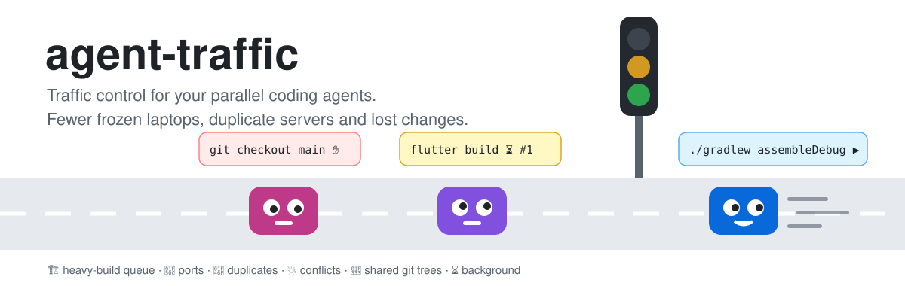
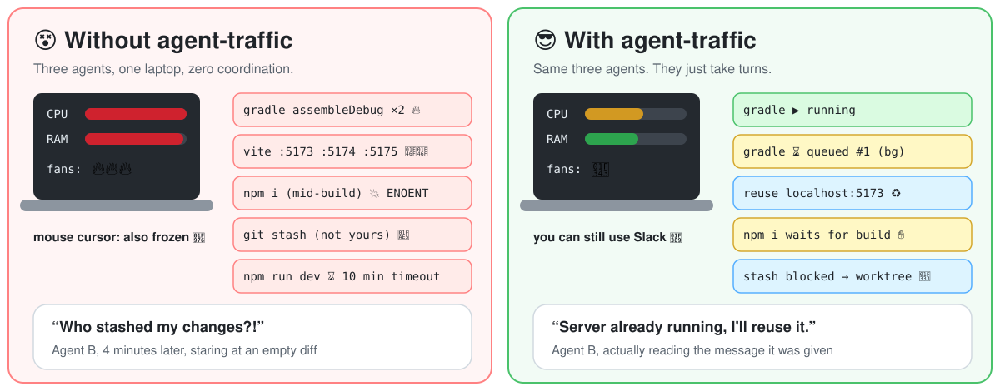
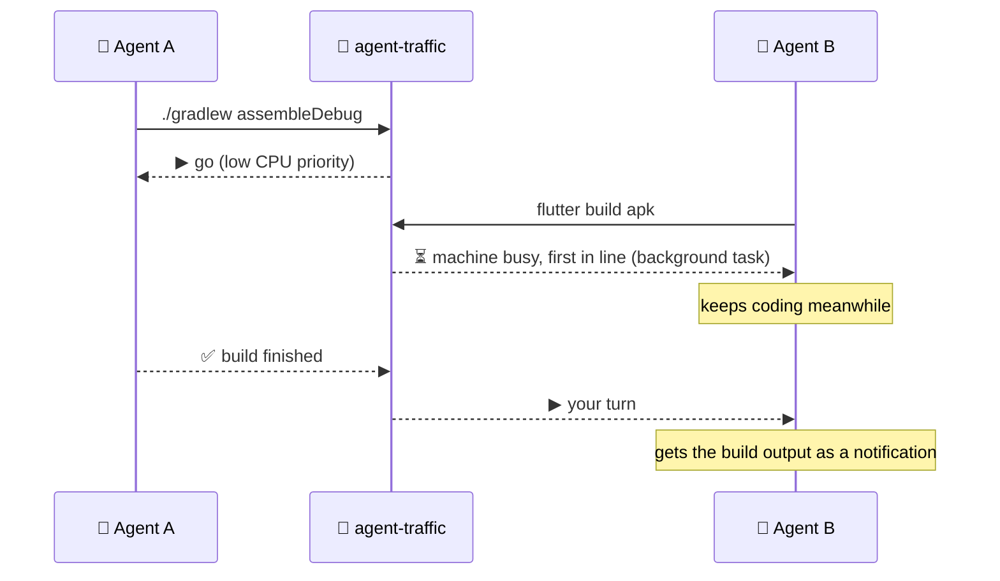
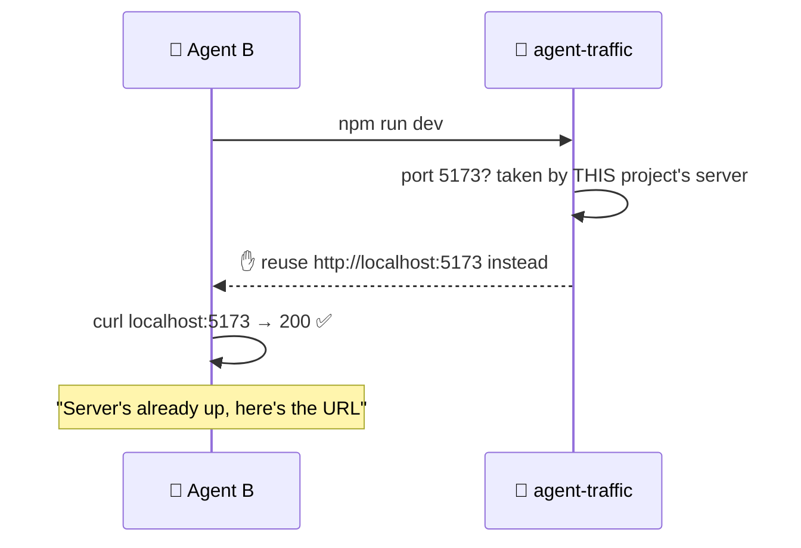
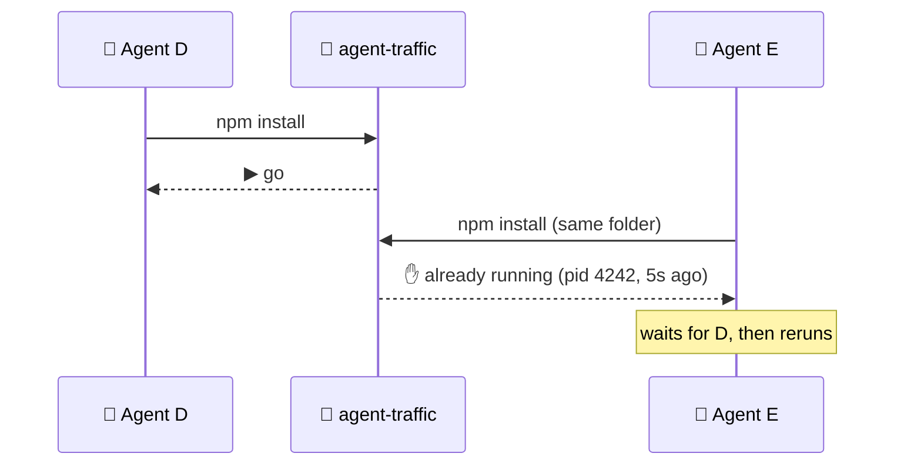
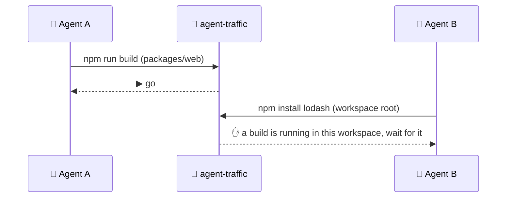
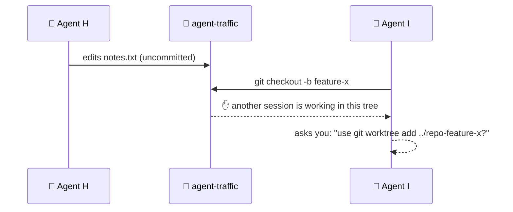
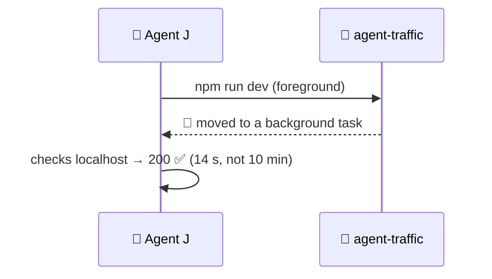
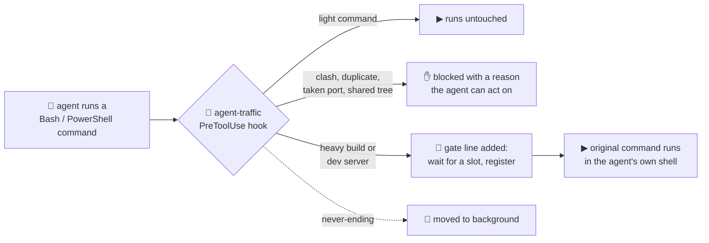

<p align="center">
  
</p>

<p align="center">
  <a href="https://github.com/goldyndevs/agent-traffic/actions/workflows/test.yml"></a>
  
  
  
  
  
</p>

You opened three Claude Code sessions to go 3× faster. Then two of them built an
APK at the same time, your fans took off, the mouse froze, and a third agent
`git stash`ed somebody else's work.

**agent-traffic** is a tiny Claude Code plugin that acts like a traffic cop for
every shell command your agents run. Heavy builds take turns, duplicate servers
get reused, clashing commands wait, and nobody switches branches under anybody
else's feet. 🚦

<p align="center">
  
</p>

## 💚 Why you'll like it

| | |
|---|---|
| 🪙 **Doesn't eat your tokens** | It makes zero AI calls and needs no API key. Ordinary commands (`git status`, `ls`, `cat`...) add **0 tokens**. A build it queues adds about **60 tokens** of context, and a block with its reason about **115**. Those are measured numbers, not vibes. |
| 💸 **Actually saves tokens** | One build that crashed because another build ran next to it dumps thousands of tokens of error log for the agent to read, "fix" and retry. agent-traffic swaps that for a ~115-token "wait your turn". |
| ⚡ **Fast** | It is plain local Node, adding roughly 60 to 100 ms per command, which is mostly Node starting up. Your commands run in your shell, unchanged. |
| 🔒 **100% local** | No network calls, no telemetry, no account. It only checks `localhost` to see if a port is taken. |
| 🧩 **Zero config, zero deps** | Install it and it works. One optional JSON file if you want to tune it. |
| 🙅 **Never sneaky** | It never rewrites your command, only adds a gate line in front. It never auto-approves anything your own permission rules wouldn't. |
| 🧹 **Crash-proof** | Every record is tied to a live process. Kill a terminal mid-build and its slot frees itself within a second. |
| 🧪 **Battle-tested** | ~150 automated checks on Linux, macOS and Windows, plus end-to-end runs with real parallel Claude Code sessions. Every scene below happened for real. |

## ⚡ Install (30 seconds)

```
/plugin marketplace add goldyndevs/agent-traffic
/plugin install agent-traffic@agent-traffic
```

There is nothing to configure and nothing to install besides `node`, which you
probably have already. Every session on the machine shares the same traffic
control from then on.

---

## 🎬 Six scenes it saves you from

### 🏗️ Scene 1: "Two APKs walk into a laptop"
Agent A runs `./gradlew assembleDebug`. A second later, Agent B runs the same
kind of build in another project, and your laptop turns into a space heater.



**heavy guard:** builds share 4 capacity units. A mobile build weighs 3, so two
never overlap. A web build weighs 2, so two can run side by side. A build joins
others only if at least 2 GB of RAM is free.

### 🔌 Scene 2: "Port 3000 is taken (by you, ten minutes ago)"
Agent B forgot that it already started the dev server. Vite quietly moves to
:5174, then :5175, and now you have three copies of the same app eating RAM.



**port guard:** it knows Vite, Next, Nuxt, Astro, Angular, Expo, Storybook,
Django, Flask, Rails, Laravel and more. It reads the port from flags,
`package.json` scripts and `vite.config`. If the port belongs to **another**
project, the agent gets a free port to use instead.

### 👯 Scene 3: "npm install, twice, at the same time"
Two sessions both decide the dependencies need refreshing, and `node_modules`
ends up in a quantum state.



**dedupe guard:** an identical command already running or queued in the same
directory is blocked.

### 💥 Scene 4: "npm install during a build"
The commands are different but just as deadly. Running `npm install` while
`npm run build` reads `node_modules` gives you a mysterious `ENOENT`, and running
`next build` while `next dev` runs corrupts `.next`.



**conflict guard:** it is workspace-aware, so a root install also protects every
package of a monorepo. It also stops `dotnet build` while `dotnet run` holds the
DLLs.

### 🌳 Scene 5: "Who switched my branch?!"
Agent H is halfway through a refactor with nothing committed yet. Agent I gets
told to "start the feature branch" and runs `git checkout -b feature-x` in the
**same folder**.



**git guard:** it blocks `checkout`, `switch`, `stash`, `reset --hard`,
`clean -f`, `restore`, `rebase`, `merge`, `pull`, `add -A` and `commit -a` while
another live session works in the same working tree. Read-only git commands and
`git add <your files>` stay allowed. A separate `git worktree` is always fine.

### ⏳ Scene 6: "npm run dev in the foreground"
The agent starts a dev server and then waits... for a process that never ends.
It sits there for 2 to 10 minutes until the tool times out.



**background guard:** dev servers, `--watch` modes, `tail -f`, `docker compose up`
without `-d`, `flutter run`, emulators and log followers go straight to the
background.

---

## 🧠 How it works



- **Your command is never rewritten.** A single gate line goes in front of it.
  Aliases, `cd`, exit codes and quoting all behave exactly as before.
- **One registry for the whole machine** lives at `~/.agent-traffic`. Every record
  is tied to a live process, so a crash or a kill frees its slot within about a
  second.
- **Blocks come with instructions** such as "reuse localhost:5173", "use
  `git worktree`" or "wait for the build". Agents are told not to override a block
  on their own. If you do want to override one, tell the agent to prefix the
  command with `AGENT_TRAFFIC_ALLOW=1`.
- **No extra permission prompts.** If your own allow rules already cover the
  original command, the gated version is auto-approved. Your deny and ask rules
  always apply.

Check what's going on at any time:

```
$ node ~/.claude/plugins/.../agent-traffic/bin/agent-traffic.js status
agent-traffic: capacity 3/4 used | CPU 61% | RAM 70% used, 9.4 GB free (jobs share only above 2.0 GB) | 16 cores
Running:
  [gradle w3] pid 18432, 2m10s, in C:\code\shop-app: ./gradlew assembleDebug
Waiting:
  #1 [flutter w3] pid 20112, waited 45s, in C:\code\rider-app: flutter build apk
Dev servers:
  [vite :5173] pid 9920, up 12m03s, in C:\code\web: npm run dev
```

---

## 🛠️ Reference

<details>
<summary><b>What counts as heavy (and how heavy)</b></summary>

Capacity is 4 units. Commands are classified by their text, not by measuring them.

| Weight | Commands |
|---|---|
| 3 | Gradle, `flutter build`, `xcodebuild`, RN/Expo native runs |
| 2 | web builds (`npm run build`, next/vite/ng/...), `dotnet build/test/publish`, `docker build`, Maven, `cargo`, `go build/test`, `swift build`, `cmake --build`, `make -j`, `ninja`, test runners (`jest`, `vitest`, `npm test`, `playwright test`, `cypress run`, `pytest -n`), `ffmpeg`, `pod install` |
| 1 | package installs (`npm/pnpm/yarn/bun install/add/remove`, `npm ci`, `dotnet restore`), `tsc --noEmit/-b/-p` |

- **Queue order:** first in, first out.
- **RAM check:** a job joins running jobs only if `minFreeMemMB` (2 GB) is free.
  A job alone always runs.
- **When the machine is busy:** the command becomes a background task and waits
  as long as needed.
- **When the machine is free:** it runs in the foreground. If it still ends up
  waiting longer than `maxWaitSec` (300 s), it exits with code 75 and prints
  `agent-traffic: BUSY`.
- **Never queued:** emulators, `docker compose up` and dev servers. They never
  finish, so they would block forever. The RAM check still accounts for them.
- **Ignored text:** quoted text, heredocs and comments. So
  `git commit -m "fix gradlew"` is not a build.
</details>

<details>
<summary><b>Conflict rules</b></summary>

A node project is compared at its workspace root (npm, yarn or pnpm), or else at
the nearest `package.json`. A dotnet project is compared at its directory.

| Incoming | Running in the same project | Result |
|---|---|---|
| node install | install, build or test | ✋ wait for it |
| node install | dev server | ▶ allowed, with a note to restart the server if needed |
| node build or test | install | ✋ wait for the install |
| `next build` | `next dev` | ✋ both write `.next` |
| `next dev` | `next build` | ✋ wait for the build |
| any dotnet command | `dotnet run` / `watch` | ✋ the running app locks bin/obj |
| any dotnet command | dotnet build or restore | ✋ wait for it |
</details>

<details>
<summary><b>Git guard details</b></summary>

- **When a session counts as active:** from its first command or edit in a
  working tree until it ends, through Claude Code's `SessionEnd` hook.
- **Crashed sessions:** a session that never ended stops counting after 4 hours
  idle, and its file is deleted after 24 hours.
- **Linked worktrees:** each one is its own working tree, which is the
  recommended way to run agents on one repo in parallel.
</details>

<details>
<summary><b>Config</b> (optional, <code>~/.agent-traffic/config.json</code>)</summary>

```json
{
  "heavy": {
    "enabled": true,
    "capacity": 4,
    "minFreeMemMB": 2048,
    "maxWaitSec": 300,
    "lowPriority": true,
    "rules": [{ "label": "my-build", "weight": 2, "pattern": "\\bmake\\s+all\\b" }],
    "disableDefaultRules": false,
    "exclude": "\\bsome-light-cmd\\b"
  },
  "port": { "enabled": true },
  "dedupe": { "enabled": true },
  "conflict": { "enabled": true },
  "background": { "enabled": true },
  "git": { "enabled": true, "activeWindowMin": 240 }
}
```

To switch everything off for a session, set `AGENT_TRAFFIC_DISABLE=1`. To use
the heavy queue from your own terminal or another agent, run
`node <plugin>/bin/agent-traffic.js run -- ./gradlew assembleDebug`.
</details>

<details>
<summary><b>Permissions</b></summary>

Claude Code checks rules against the gated command, so the gate line alone would
cost you an extra prompt. To avoid that, agent-traffic auto-approves a gated
command only when one of your own allow rules already covers the original
command. It reads those rules from `~/.claude/settings.json` and from the
project's `.claude/settings.json` and `.claude/settings.local.json`.

It is deliberately stricter than Claude Code's own matcher:
- only a single simple command counts, optionally after `cd <dir inside project> &&`;
- only exact rules and rules with a trailing `:*` or ` *` count;
- only the default and acceptEdits modes count.

In every other case you get the normal prompt. Rules passed with
`--allowedTools` on the CLI are not visible to the hook.
</details>

<details>
<summary><b>Known limits</b></summary>

- **Commands it can't see:** commands hidden inside quotes
  (`bash -c "./gradlew build"`), and git run through aliases (`gco`) or behind an
  env prefix.
- **`&` backgrounding:** a command backgrounded with `&` inside the command line
  keeps running after the shell exits, so its record is dropped early.
- **Port detection is best effort:** a port set only in code or in `.env` is not
  seen. Such a command is never blocked.
- **Only agent commands:** commands you start yourself in another terminal are
  invisible, unless you run them through `agent-traffic.js run`.
- **Ecosystems:** the conflict rules cover node and dotnet. Python, Gradle and
  others are not covered yet.
- **Gradle daemon:** a daemon that was already running is not re-prioritised. Cap
  Gradle with `org.gradle.workers.max` in `gradle.properties` if needed.
- **Other agents:** only Claude Code is hooked automatically.
</details>

---

## 🧪 Development

```
bash test/run-tests.sh      # ~150 checks, isolated state, Linux / macOS / Windows
bash test/e2e.sh            # real parallel headless Claude sessions (slow, uses tokens)
```

| Path | What lives there |
|---|---|
| `hooks/pretooluse.js` | the traffic cop: runs every guard on each command |
| `hooks/activity.js` | records edits and session ends for the git guard |
| `guards/` | one file per guard: heavy, port, dedupe, conflict, git, background |
| `core/` | registry, sessions, config, permissions, command and project parsing |
| `bin/agent-traffic.js` | CLI: `acquire`, `register`, `run`, `status` |

The project has zero dependencies and is MIT licensed. PRs adding guards for more
ecosystems are very welcome. 🚦
